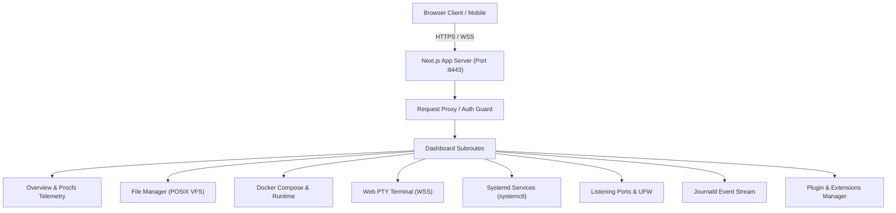

# Architecture Documentation

## 1. System Overview

**Pratama Server Host** is a lightweight, self-hosted web control panel and host telemetry interface designed for direct installation on Linux VPS and bare-metal nodes. It provides kernel forensics, systemd unit supervision, network socket exposure auditing, and container orchestration with minimal system footprint.

---

## 2. Layered Architecture

The application adopts a feature-oriented, domain-driven structure to maximize separation of concerns:

- **Routing & Composition (`src/app/`)**: Handles Next.js App Router route segments, layouts, error boundaries, and loading skeletons. Logic is kept out of route pages and delegated to feature models.
- **Components Layer (`src/components/`)**:
  - `ui/`: Primitive accessible design system components based on `@base-ui/react` and Radix primitives styled with Tailwind CSS v4.
  - `layout/`: Top navigation header, responsive left sidebar (desktop fixed, mobile slide-over sheet), and theme controller.
- **Domain Types (`src/types/`)**: Unified TypeScript interfaces for telemetry, processes, files, services, containers, network sockets, plugins, and authentication credentials.
- **Configuration & Constants (`src/config/`)**: Centralized site parameters, navigation taxonomy, and plugin catalogs.
- **State & Context (`src/context/`)**: Client-side reactive contexts (e.g. `PluginsProvider`) persisted safely via browser storage.
- **Security & Proxy (`src/proxy.ts`, `src/lib/auth.ts`)**: Server-side request gating, session cookie verification, and route protection.

---

## 3. Communication Protocols

1. **REST APIs / Server Functions**: Used for query data exchange, process inspection, and atomic daemon configurations.
2. **WebSocket (WSS)**: Dedicated full-duplex streaming channel for:
   - Interactive PTY shell execution (`/dev/pts/*`).
   - Real-time journald incident stream (`journalctl -f`).
   - Dynamic system load graphs (CPU, RAM, Inodes, Latency).

---

## 4. Extensibility & Plugin Model

Host extensions (e.g., Docker Engine, Caddy Reverse Proxy, PostgreSQL, Redis) follow a decoupled plugin paradigm:
- Routes depending on uninstalled host extensions remain securely locked in the navigation hierarchy.
- The `PluginsProvider` provides atomic installation hooks and state resolution without requiring frontend recompilation.

